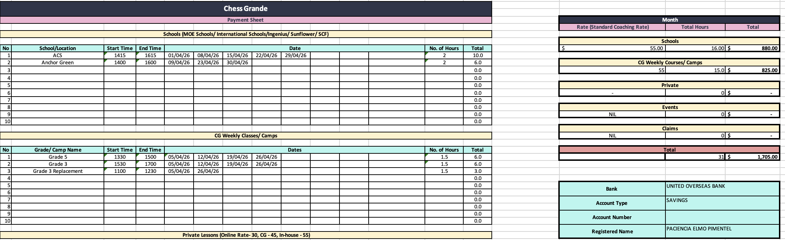

# Chess Grande Payroll Portal

A web app for Chess Grande timesheets and payroll. It replaces the monthly Excel sheet with a shared calendar, pay review, and submission workflow.

## What it does

- **Employees** log coaching sessions, replacements, private lessons, camps, events, and expenses. They review their pay and submit payroll.
- **Managers** review submissions, mark payments as paid, manage pay rates, edit employee drafts, and send notices.
- **Webadmins** manage user profiles and account roles.
- Coaches receive monthly hourly pay. Trainees receive a fixed weekly stipend for each completed week with eligible work.
- Claim receipts are stored privately. AI tools can import Excel timesheets and answer webadmin questions using uploaded support documents.

## Screenshots

These screenshots use real Singapore school names, with Elmo as the main user. Staff details, schedules, and pay amounts are examples. Contact numbers and bank accounts are hidden.

### Employee timesheet

View the month, add entries, and group work by activity.

### Pay review

Check hours, pay, and profile details before submitting.

### Manager dashboard

Review employee submissions, filter payment status, and mark payroll as paid.

### Webadmin directory

Search users, edit profiles, and manage roles and AI model settings.

### Original Excel workflow

The original payment sheet before the web app.

## Stack and deployment

- Plain HTML, CSS, and JavaScript.
- Supabase Auth and Postgres with Row Level Security.
- A Cloudflare Worker and private R2 buckets for receipts and support documents.
- OpenRouter and LangChain for optional AI features.

Host the frontend on Cloudflare Pages or Vercel. No frontend build is needed. Deploy the Worker separately and configure its bindings and secrets.

Set up Supabase using [supabase-schema.sql](supabase-schema.sql). New accounts start as employees; grant manager or webadmin access through trusted administration.
