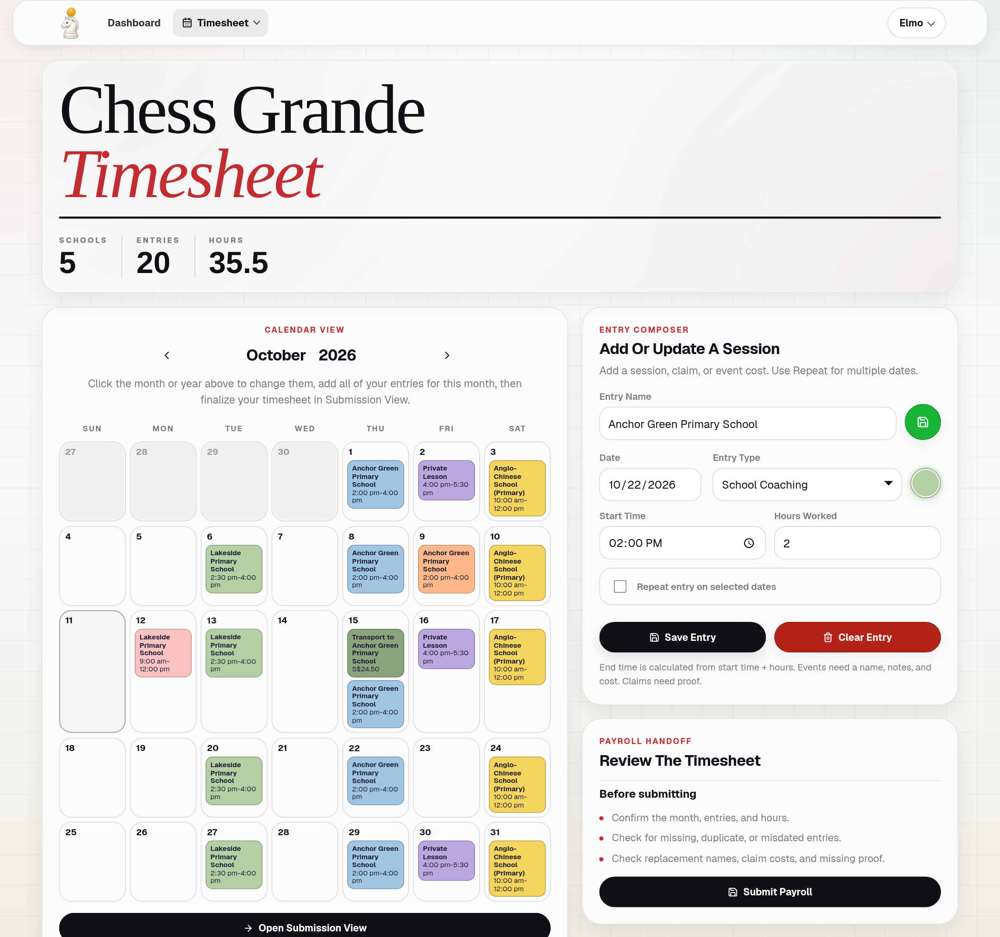
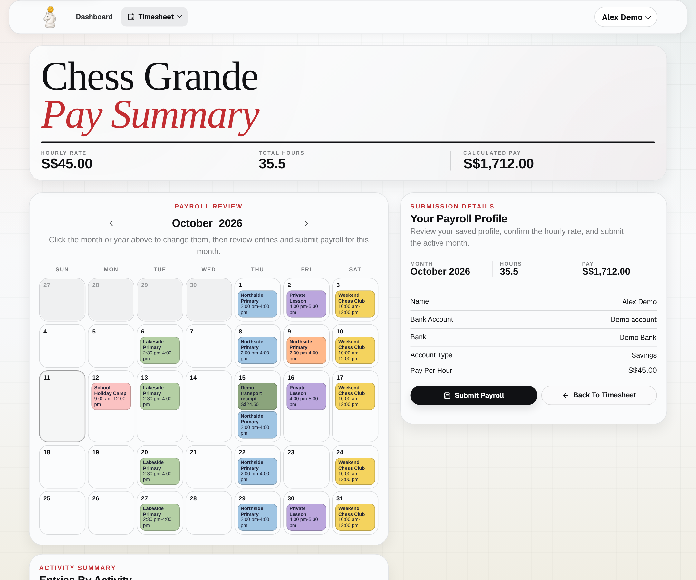
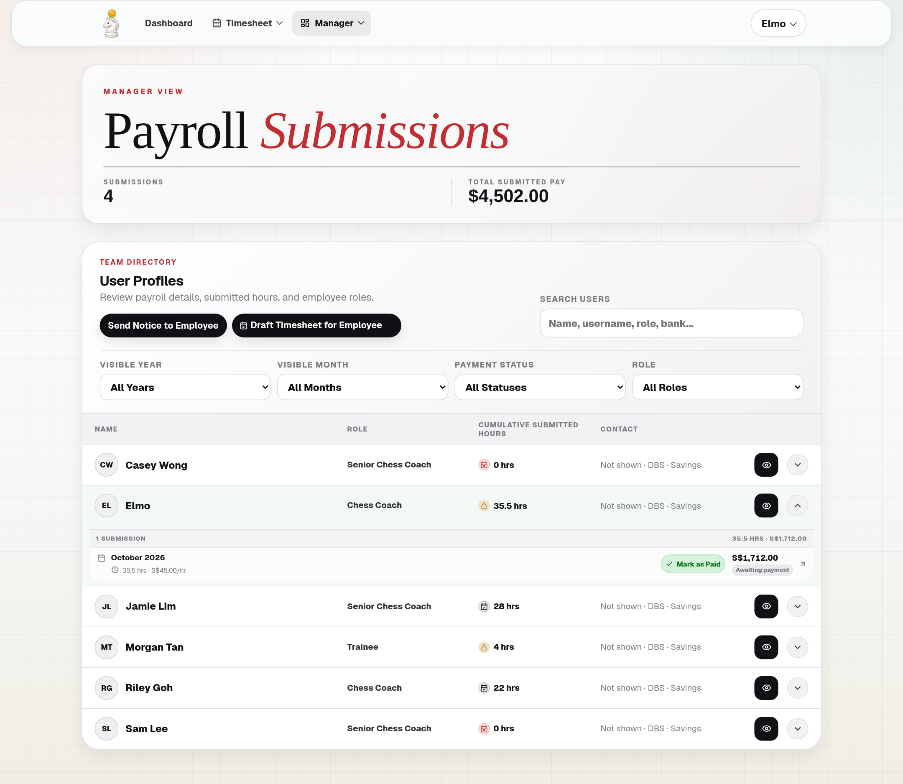
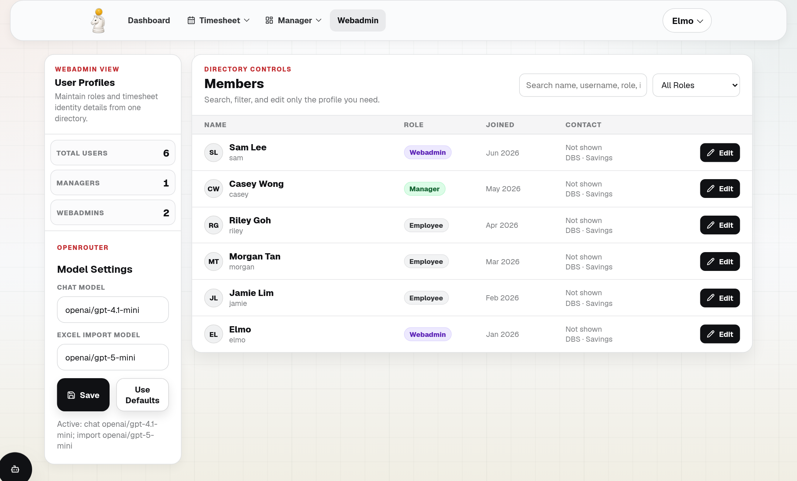

# Chess Grande Payroll Portal

A web app for Chess Grande timesheets and payroll. It replaces the monthly Excel sheet with a shared calendar, pay review, and submission workflow.

## What it does

- **Employees** log coaching sessions, replacements, private lessons, camps, events, and expenses. They review their pay and submit payroll.
- **Managers** review submissions, mark payments as paid, manage pay rates, edit employee drafts, and send notices.
- **Webadmins** manage user profiles and account roles.
- Coaches receive monthly hourly pay. Trainees receive a fixed weekly stipend for each completed week with eligible work.
- Claim receipts are stored privately. AI tools can import Excel timesheets and answer webadmin questions using uploaded support documents.

## Screenshots

These screenshots show the current app with fictional demo data. Names, contact details, bank details, and pay amounts are examples.

### Employee timesheet

View the month, add entries, and group work by activity.



### Pay review

Check hours, pay, and profile details before submitting.



### Manager dashboard

Review employee submissions, filter payment status, and mark payroll as paid.



### Webadmin directory

Search users, edit profiles, and manage roles and AI model settings.



## Run locally

Use Node.js 22 or newer and Python 3.

```bash
npm ci
python3 -m http.server 8080
```

Open `http://localhost:8080`. The home page redirects to `login.html`.

The frontend uses the service URLs in [supabase-client.js](supabase-client.js) and [claim-proof-storage.js](claim-proof-storage.js). It needs a configured Supabase project for sign-in and saved data.

To run the separate claim-proof and AI Worker locally:

```bash
npm run worker:dev
```

See [the Worker](cloudflare-worker/claim-proof-worker.js) for required bindings and secrets, and [its configuration](cloudflare-worker/wrangler.toml) for R2 bucket settings. The frontend continues to use its configured Worker URL.

## Checks

```bash
npm test
npm run worker:dry-run
```

The weekly-pay test currently fails because two SQL migration files are missing from `supabase/migrations/`.

## Stack and deployment

- Plain HTML, CSS, and JavaScript.
- Supabase Auth and Postgres with Row Level Security.
- A Cloudflare Worker and private R2 buckets for receipts and support documents.
- OpenRouter and LangChain for optional AI features.

Host the frontend on Cloudflare Pages or Vercel. No frontend build is needed. Deploy the Worker separately and configure its bindings and secrets.

Set up Supabase using [supabase-schema.sql](supabase-schema.sql). New accounts start as employees; grant manager or webadmin access through trusted administration.
